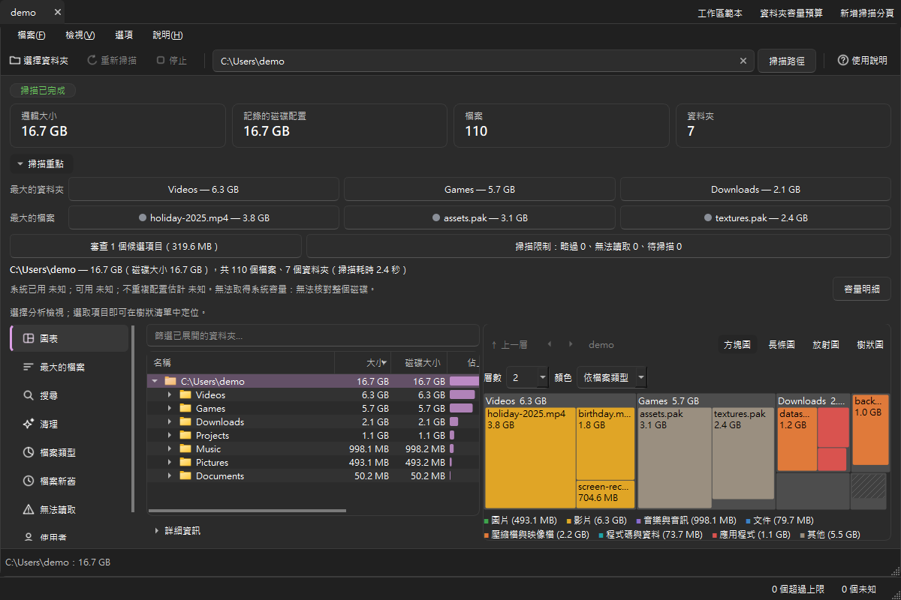

# FileTree

**快速找出磁碟空間都被什麼占用了。**

FileTree 會掃描資料夾或磁碟，列出最占空間的檔案與資料夾。
透過資料夾樹、彩色方塊圖和最大檔案清單，幫你決定哪些要保留、哪些可以清理。

[English](../README.md) | [繁體中文](README_zh-TW.md) | [简体中文](README_zh-CN.md) | [日本語](README_ja.md) | [한국어](README_ko.md)



在預算清單使用方向鍵選列、Tab 前往編輯欄位。重新開啟搜尋時，名稱欄位會捲動至可見位置。

## 可以做什麼

- 在「資料夾容量預算」設定精確上限。用量與超額量沿用所選大小單位，並分開顯示觀察時間、等待掃描與未知狀態。 從詳細資訊開啟所選資料夾的趨勢或預算。按超額或未知數量，可查看符合的預算。
- 將管理視窗開啟時的分頁儲存為具名工作區範本；另行編輯載入預覽，查看即時取代影響，載入後按開始才掃描。
- 結果重點會列出最大的資料夾與最大的檔案，以及清理候選項目與掃描限制。「最大的檔案」與「搜尋」中的彩色圓點和**可否刪除**欄，會說明檔案是可清理、要先確認、由您自行決定，還是請勿刪除。
- **查看實體磁碟**：「檢視 → **實體磁碟…**」列出每顆實體磁碟的類型、健康狀態、系統有回報時的溫度與耗損，以及分割配置。此畫面唯讀，並可開啟 Windows 的磁碟工具。
- **規劃如何釋放空間**：「檔案 → **釋放空間…**」先問您需要多少空間，再把掃描找到的項目排成步驟，最安全的排在前面。不會替您勾選任何項目，您勾選的項目仍須經過資源回收筒的審查與確認。
- **預測磁碟何時會滿**：「磁碟總覽」為每個磁碟顯示剩餘空間預測，例如每天約 2 GB 與預估用滿的日期，依據是開啟總覽時 FileTree 記錄的已用空間。可以在該畫面關閉記錄。
- **只在您要求時永久刪除**：Shift+Del 會不經資源回收筒刪除選取的項目。FileTree 每次都會先詢問，只刪除您同意的項目，掃描後有變動的一律保留。
- 從首頁或「選項」儲存常用掃描設定，重複載入路徑與掃描選項。開啟編輯器不會中斷其他分頁的掃描。
- 清理後保留結果數字，並提供操作紀錄、可用的復原與明確重新掃描原資料夾的入口。
- 只在您要求時掃描：清理或其他檔案操作之後，FileTree 會直接更新能更新的結果，並提供「重新掃描變動的資料夾」，不會自行重新掃描。
- **把 CPU 留給其他程式**：其他程式正在使用 CPU 時，掃描會減少讀取執行緒；CPU 空閒時恢復原本的數量。可在「選項」關閉。
- **更快掃描 NTFS 磁碟**：以系統管理員身分執行並掃描 NTFS 磁碟或其中的資料夾時，FileTree 直接讀取磁碟的檔案表，不必逐一開啟每個資料夾。可在「選項」關閉。
- **找出大檔案、大資料夾**：從最大的項目開始看，清理或重新掃描資料夾後也會依更新的大小排序，並用圖表了解空間占比。瀏覽與篩選會重用已排序的資料列，尚未展開的子資料夾則按需排序。
- **搜尋與篩選**：依名稱、類型、大小或修改時間找檔案。排序、切換單位或資料夾樹篩選時會保留仍可見的選取項目；樹狀篩選會重用相同結果，為每個已開啟群組建立一次映射，並略過隱藏的壓縮檔成員。切換樹狀篩選時，會保留大量選取及未選取的間隔，並減少暫存資料。大量結果清單排序時，每列只計算一次排序值。自訂範圍支援精確大小與包含起訖日的本機日期，儲存的搜尋會保留這些範圍。
- **查看清理建議**：檢視快取、暫存檔和重複檔案，再決定是否處理。大型清單切換單位或語言時會保留選取；大量已略過或移動失敗的項目，可在完整表格中檢視及複製。選擇重複檔案的保留副本與空間估算完成時，都會保留選取與檢視位置。群組結果會一併展開，保留所有列出的檔案。 審閱表集中顯示勾選、路徑、邏輯大小與風險；完整證據及後果可捲動閱讀並複製。
- **找出變大的資料夾**：比較前後兩次掃描，看看空間增加在哪裡。
- **追蹤資料夾趨勢**：在掃描歷史選擇已載入資料夾及近期或自訂期間。選取圖表觀察點或紀錄列，查看容量、有號變化及未知原因。 在已載入資料夾選擇器中，Enter 進入資料夾；按「使用此資料夾」才確認目前資料夾。
- **匯出報表**：將結果存成 CSV、JSON 或 Excel。 大量清單複製會分批準備資料列與文字；任何清單的新複製都會取代尚未完成的要求。
- **切換語言**：支援英文、繁體中文、簡體中文、日文和韓文。
- **調整文字大小**：用「檢視 → 文字大小」把整個程式的文字放大或縮小（90% 到 200%），並記住選擇。使用說明會以較大的文字顯示，淺色與深色主題的文字和控制項都維持高對比。
- **計算另一台電腦**：用自己的金鑰透過 SSH 唯讀掃描資料夾，再比較結果。
- **封存舊資料夾**：壓成 ZIP 並讀回比對，之後再決定如何處理原始資料。
- **比較多台電腦**：把多台電腦匯出的資料夾樹並排比較。
- **查看開發工具佔用的空間**：Docker、pip、npm、Cargo 等，附上可複製的官方指令。
- **快速找到指令**：按 Ctrl+K 輸入文字即可，也能在選項中自訂快速鍵。
- **刪除前先看內容**：詳細資訊可預覽圖片、文字開頭與壓縮檔裡的項目。
- **找出問題檔案**：空檔案、失效的連結與捷徑、過長的路徑，以及 Windows 不允許的名稱。
- **自訂清理規則**：指定要找的資料夾或檔案，找到的項目一律由你審查。
- **設定集中在一處**：「選項 → 設定…」（Ctrl+,）可搜尋所有設定，也能匯出與匯入。
- **檔案總管資料夾選單（Windows）**：從「選項」加入「使用 FileTree 掃描」。設定操作時視窗仍可回應；已開始的儲存完成後才會關閉。

搜尋結果上方顯示已套用條件，可逐項解除或全部清除，日期也可從日曆選取。

## 安裝

### Windows：免安裝 Python

1. 到 [Releases](https://github.com/JeffreyChen-s-Utils/FileTree/releases) 下載 `FileTree-<version>-windows-standalone.zip`。
2. **完整解壓縮** ZIP 檔。
3. 執行資料夾內的 `FileTree.exe`，其他檔案請一起保留。

也提供 MSI 安裝程式，可透過 Windows 安裝。

### Windows、macOS、Linux：使用 Python

需要 **Python 3.11 以上**：

```bash
python -m pip install je_file_tree
je-file-tree
```

Windows 可以用 `py -3` 代替 `python`。
從原始碼執行或編譯成獨立程式，請看[完整說明](../docs/guide_zh-TW.md)與[編譯指南](../nuitka.zh-TW.md)。

## 開始使用

1. **選擇資料夾或磁碟**，也可以直接把資料夾拖進視窗。
2. **等待掃描完成**，查看最大的資料夾和檔案。圖上的方塊越大，表示占用空間越多。
3. **確認不需要的項目**，按右鍵 → **移到資源回收筒**。程式會先詢問確認，並照原樣顯示檔名與路徑。

掃描途中可以隨時停止；已讀取的結果會保留，並標示為不完整。
掃描發生非預期錯誤時會回報失敗；工作執行緒失敗後不會將結果標示為完成。
工作執行緒啟動失敗時，會先等待已啟動的工作者結束，再顯示錯誤。
開始新的掃描會取消尚未完成的資料夾列表統計，並捨棄舊結果。

## 使用前知道這些就好

- 檔案移到資源回收筒後，**要清空資源回收筒才會釋出空間**。
- 清理建議需要自行檢查。背景監視預設關閉，也不會自動清理。
- 沒有讀取權限的資料夾會列在**無法讀取**分頁中，裡面的內容不會計入總大小。
- 掃描不會跟隨符號連結或接合點。檔案大小與實際占用磁碟空間可能不同。
- Windows 啟動時可能詢問系統管理員權限；拒絕後仍可掃描有權限讀取的資料夾。從視窗要求重新啟動時，會在背景等待；請完成或關閉 Windows 提示。重新啟動會依序重開掃描分頁，保留各分頁目前的掃描選項，重新掃描各自的資料夾清單。
- 清空資源回收筒、將重複檔案改成硬連結等進階操作，有各自的確認步驟與影響；使用前請看[完整說明](../docs/guide_zh-TW.md)。

## 常用快速鍵

| 按鍵 | 功能 |
|---|---|
| Ctrl+O | 選擇資料夾 |
| F5 | 重新掃描 |
| Esc | 停止掃描 |
| Ctrl+F | 搜尋 |
| Delete | 將選取項目移到資源回收筒 |
| Ctrl++／Ctrl+- | 放大／縮小文字 |
| Ctrl+0 | 文字恢復系統大小 |
| Ctrl+, | 設定 |
| Ctrl+K | 尋找指令 |
| F1 | 開啟說明 |
| Ctrl+Q | 結束程式 |

macOS 請用 ⌘ 代替 Ctrl，重新掃描則用 ⌘R。

## 更多說明

- [完整使用說明與技術細節](../docs/guide_zh-TW.md)：所有功能、命令列範例、設定與限制。
- [編譯指南](../nuitka.zh-TW.md)：用 Nuitka 建立獨立程式。
- [核心 API](../docs/core-api.md)與[專案架構](../architecture.md)：串接或開發 FileTree。
- [更新紀錄](../docs/updates/README.md)：功能變更與驗證紀錄。

## 安全性

漏洞請私下回報。政策、支援版本與操作者注意事項見 [SECURITY.md](../SECURITY.md)。

## 授權

[MIT](../LICENSE)。
